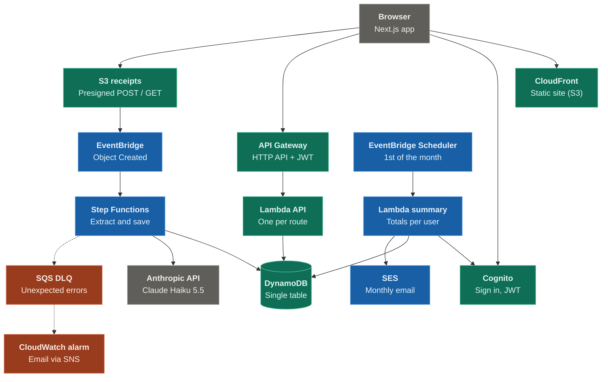
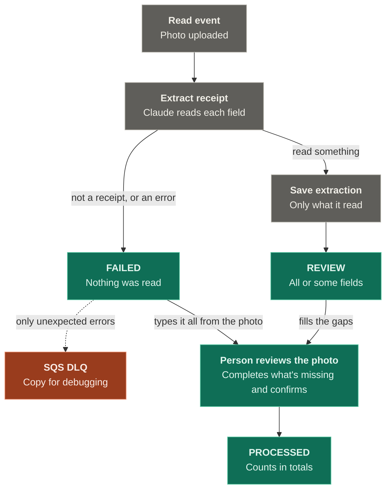

# Receipts App

Serverless expense tracker built from receipt photos: sign up, upload a photo of a receipt, and see your spending by month and category. A portfolio and learning project for the AWS Solutions Architect Associate and Developer Associate certifications, with groundwork for DevOps Pro and GenAI Developer Pro.

The domain is deliberately small. The interesting part is the AWS architecture, kept within the free tier or a few cents a month.

**Live:** https://d320g8bknug8ck.cloudfront.net

## Features

| Feature | Status |
|---|---|
| Sign up, email confirmation (OTP), sign in, password reset | ✅ Done |
| Expenses: list by month, totals by category, create, edit, delete | ✅ Done |
| Upload a receipt photo from the camera or a file (resized in the browser, presigned POST to S3) | ✅ Done |
| AI extraction of merchant, total, date and category (Claude Haiku 5.5), field by field | ✅ Done |
| Review what the AI read next to the photo, fill in the gaps and confirm | ✅ Done |
| View a receipt photo; deleting an expense deletes its photo | ✅ Done |
| Monthly summary by email: totals per currency and category, plus receipts waiting for review | ✅ Done |

The UI is bilingual (English by default, Spanish) and follows WCAG 2.2 AA.

## Architecture



Green is the request path, blue the asynchronous and scheduled work, gray what runs outside AWS, and red what needs the developer's attention.

### Receipt lifecycle



Gray steps are automated, green ones are statuses and the person's part, and red needs the developer's attention. `PROCESSED` expenses can still be edited (`PATCH`).

1. `POST /receipts` creates a `PENDING` expense and a presigned POST. The browser resizes the photo (longest edge 1568 px, JPEG) and uploads it straight to S3.
2. S3 emits `Object Created` to EventBridge, which starts a Step Functions (Standard, JSONata) workflow:
   1. **ExtractReceipt** reads the photo with Claude. Each field (merchant, total, currency, date, category) can come back empty when it can't be read with confidence.
   2. **SaveExtraction** stores only the fields that were read and sets `REVIEW`. The write is conditioned on `status = PENDING`, so a duplicate event or an expense deleted meanwhile changes nothing.
   3. On failure, **MarkFailed** sets `FAILED`. An unreadable photo ends there; any other error also goes to an SQS dead-letter queue and fails the execution.
3. The web polls the month while receipts are `PENDING`. A `REVIEW` receipt opens next to its photo with the unread fields flagged, and `POST /expenses/{id}/confirm` makes it `PROCESSED`.

Only `PROCESSED` expenses count in the totals; the summary says how many receipts are waiting for review.

### AI extraction

The `extract-receipt` Lambda sends the receipt photo to **Claude Haiku 5.5** through the Anthropic API and gets back JSON that matches the shared Zod contract (`receiptExtractionSchema`), thanks to structured outputs. Every field is optional: what the model can't read with confidence comes back empty instead of guessed, and the person fills it in during review. When the photo is not a receipt at all, the model returns no expense and a reason, and the receipt is marked `FAILED`.

- **Why not Bedrock:** the original design used Amazon Bedrock. On this new account every Bedrock inference quota is 0, and AWS Support declined to raise them until the account has more usage history (see [Account constraints](#account-constraints)).
- **Swappable provider:** the handler depends on a `ReceiptExtractor` function type, so moving back to Bedrock only needs a new implementation.
- **Secrets:** the API key belongs to a dedicated service account, lives in an SSM `SecureString`, and is read at runtime with Powertools Parameters. It never appears in code, environment variables or CloudFormation.
- **Cost:** about $0.0004 per receipt. The Claude Console organization has a monthly spend limit, so a bug or abuse can't run up the bill.
- **Prompt injection:** text printed on the receipt is treated as data, and the output is validated with Zod like any other external input.

### Request flow

1. The static Next.js export is served from a private S3 bucket through CloudFront with Origin Access Control. A CloudFront Function maps clean URLs (`/sign-in`) to the exported `.html` files, and a response headers policy adds CSP, HSTS and other security headers.
2. The browser talks to Cognito directly (SRP sign-in through Amplify) and keeps short-lived, revocable tokens.
3. Every API route requires the Cognito access token. API Gateway validates the JWT before any Lambda runs, and the user id always comes from the token's `sub`, never from the request.
4. Lambdas validate all input with the shared Zod contracts and read and write a single DynamoDB table. Expenses are listed per month through a GSI with paginated queries.
5. Receipt photos go straight from the browser to S3 with a presigned POST, whose policy (type and size limit) S3 itself enforces. They are viewed the same way, with a 5-minute presigned GET from `GET /expenses/{id}/receipt`; the bucket stays private.

### Monthly summary

EventBridge Scheduler invokes the `send-monthly-summaries` Lambda at 8:00 Bogotá time on the 1st of each month (Scheduler supports time zones; EventBridge rules only run on UTC). For each enabled, confirmed Cognito user it:

1. queries last month's expenses through `GSI1`, like `GET /expenses`
2. adds up the `PROCESSED` ones per currency and category (amounts in different currencies are never added together) and counts the receipts still in `REVIEW` or `FAILED`
3. writes an idempotency marker (`SUMMARY#yyyy-mm`) with `attribute_not_exists`, then sends a plain-text email through SES

Scheduler and Lambda deliver at least once, so a retry finds the marker and doesn't email anyone twice. If SES fails, the marker is deleted so the retry can send it. People with nothing in the month get no email.

A manual invocation can pass `{ "month": "YYYY-MM" }` to summarize another month; delete the marker it leaves if that month will be summarized again by the schedule.

### Resilience

| Concern | How it is handled |
|---|---|
| Duplicate S3 events, or an expense deleted while it is read | Every workflow write is conditioned on `status = PENDING` |
| Transient Lambda and model errors | Step Functions retries Lambda service errors; the Anthropic SDK retries network errors and 429s |
| Unexpected processing errors | The receipt is marked `FAILED` (the person can still complete it) and the error goes to an SQS dead-letter queue |
| Nobody looking at the DLQ | A CloudWatch alarm on `ApproximateNumberOfMessagesVisible > 0` emails the developer through SNS, and again when the queue is empty |
| Uploads that never arrive | `POST /receipts` gives the `PENDING` expense an `expiresAt` one day ahead and the table's TTL deletes it; leaving `PENDING` removes the attribute |
| Summary retries | The `SUMMARY#yyyy-mm` marker, which the TTL also removes after 90 days |

### Data model (single table)

| Item | PK | SK | GSI1PK | GSI1SK |
|---|---|---|---|---|
| Expense / receipt | `USER#<userId>` | `RECEIPT#<id>` | `USER#<userId>` | `DATE#<yyyy-mm-dd>` |
| Monthly summary sent | `USER#<userId>` | `SUMMARY#<yyyy-mm>` | — | — |

The table's TTL attribute is `expiresAt` (epoch seconds), set on `PENDING` expenses and on summary markers. Summary markers have no `GSI1` keys, so they never appear in the monthly listing.

An expense is a discriminated union on `status`:

| Status | Data |
|---|---|
| `PENDING` | An uploaded photo the AI hasn't read yet: `imageKey` and the upload date |
| `REVIEW` | What the AI read; merchant, total, currency and category are each optional. `date` is the receipt date when it was read, otherwise the upload date |
| `PROCESSED` | Complete and confirmed: merchant, total, currency, date and category |
| `FAILED` | The photo couldn't be read; the person can complete it from the photo |

Writes check the status with condition expressions: the workflow only updates `PENDING` items, confirmation only accepts `REVIEW` or `FAILED`, and `PATCH` only edits `PROCESSED`. `ReturnValuesOnConditionCheckFailure` tells a missing expense (404) from one in the wrong status (409) without an extra read.

## Tech stack

- **Language:** TypeScript (strict) everywhere, TypeScript 7
- **Infrastructure:** AWS CDK v2
- **Frontend:** Next.js 16 static export, React 19, Tailwind CSS v4, Amplify Auth
- **Backend:** AWS Lambda (Node.js 24, arm64) bundled with esbuild, Powertools (Logger, Parameters), AWS SDK v3
- **AI:** Claude Haiku 5.5 through the Anthropic TypeScript SDK, with structured outputs
- **Contracts:** Zod schemas shared by the web, the API and the tests
- **Tests:** Vitest (unit), `aws-cdk-lib/assertions` (infrastructure), an end-to-end smoke test against the deployed API
- **Tooling:** pnpm workspaces, Biome (lint and format), GitHub Actions

## Repository structure

```
receipts-app/
├─ apps/web/            Next.js static site            → apps/web/README.md
├─ services/api/        Lambda handlers                → services/api/README.md
├─ packages/contracts/  Zod schemas and shared types   → packages/contracts/README.md
└─ infra/               CDK app and stacks             → infra/README.md
```

Each package is organized by feature (for example `expenses/`, `receipts/`, `auth/`), with shared code in `shared/`, `lib/` or `components/`.

## Getting started

### Prerequisites

- Node.js 24 and pnpm 12 (`corepack` or the version pinned in `package.json`)
- AWS CLI v2, signed in (`aws login`), default region `us-east-2`
- An AWS account bootstrapped for CDK in `us-east-2`:

```bash
pnpm --filter @receipts-app/infra exec cdk bootstrap aws://<account-id>/us-east-2
```

### Install

```bash
pnpm install
```

### Deploy

The AI extraction needs an Anthropic API key in SSM before `ProcessingStack` is deployed. CDK can't create `SecureString` parameters (and the value would end up in the template), so it is created once by hand:

```powershell
$key = Read-Host "Anthropic API key" -MaskInput
```

```powershell
aws ssm put-parameter --name /receipts-app/anthropic-api-key --type SecureString --value $key
```

The infrastructure reads two email addresses from `infra/.env` (see `infra/.env.example`), which is not committed:

| Variable | Used for |
|---|---|
| `SENDER_EMAIL` | Required. Sender of the monthly summary, verified in SES on the first deploy (open the link AWS emails you). While SES is in the sandbox, recipients must be verified too. |
| `ALARM_EMAIL` | Optional. Receives the dead-letter queue alarm; confirm the SNS subscription from the email. A deploy without it removes the subscription. |

Then, from `infra/`:

```bash
pnpm exec cdk deploy AuthStack DataStack ApiStack ProcessingStack NotificationsStack
```

Copy the stack outputs into `apps/web/.env.local` (see `apps/web/.env.example`), then build the site and deploy it:

```bash
pnpm --filter @receipts-app/web build
```

```bash
pnpm --filter @receipts-app/infra exec cdk deploy WebStack
```

### Run locally

```bash
pnpm --filter @receipts-app/web dev
```

The local site at http://localhost:3000 uses the deployed Cognito pool and API.

## Scripts

Run from the repository root:

| Command | What it does |
|---|---|
| `pnpm check` | Lint and format check (Biome) |
| `pnpm fix` | Apply Biome fixes and formatting |
| `pnpm typecheck` | Type-check contracts, API and infra (the web is type-checked by `next build`) |
| `pnpm test` | Unit and infrastructure tests in every package |
| `pnpm --filter @receipts-app/api smoke` | End-to-end test against the deployed API (asks for an access token) |
| `pnpm --filter @receipts-app/api exec tsx scripts/upload-receipt.ts <photo>` | Uploads a real receipt through the API and waits for the workflow |

## Quality and CI

- **Unit tests** cover the pure logic: DynamoDB key mapping and update expressions (including what an extraction saves and that it removes the expiry), receipt keys, the monthly summary (per-currency totals, review count, email text), money formatting, month logic, the client cache and polling, photo resizing, review helpers, form schemas.
- **Infrastructure tests** turn the project rules into checks:
  - every API route requires the JWT authorizer, and the receipt routes exist
  - no IAM statement grants `*`, in the API, the processing workflow or the summary
  - buckets are private
  - the table is on-demand and expires items by `expiresAt`
  - Lambdas run on Node.js 24 and arm64
  - log groups keep one week of logs
  - the workflow is Standard, starts only for `receipts/` uploads, only writes with `UpdateItem` (removing the expiry when it marks a failure) and only reads the Anthropic key from SSM
  - the dead-letter queue is encrypted, keeps messages for 14 days, and alarms by email on its first message
  - the summary runs on the 1st at 8:00 Bogotá time, only lists users and only sends from the verified sender
  - CloudFront sends the security headers
- **Smoke test:** exercises the deployed API end to end, including a real presigned upload to S3 and checks that S3 rejects a mismatched file type.
- **GitHub Actions** (`.github/workflows/ci.yml`) runs lint, type-check, the web build and all tests on every push and pull request, on Linux.

### Continuous deployment

Every push to `main` that passes the checks is deployed by the `deploy` job of the same workflow:

1. It runs only after `verify` succeeds, only for pushes to `main` (never for pull requests), and one at a time (`concurrency`).
2. It uses the GitHub environment `production`, which only `main` can deploy to. The environment holds the AWS credentials as secrets, and the public `NEXT_PUBLIC_*` values, `SENDER_EMAIL` and `ALARM_EMAIL` as variables.
3. It builds the site with the real values and runs `cdk deploy --all`.

AWS access goes through the `github-deployer` IAM user (`CiStack`). Its only permission is `sts:AssumeRole` on the CDK bootstrap roles, so the key alone can't read or change anything: every change goes through CloudFormation. An access key is used instead of OIDC because of the account's SCP (see [Account constraints](#account-constraints)).

## Security

- Least-privilege IAM through CDK `grant*` methods: for example, the list Lambda can only read, the upload Lambda can only write under `receipts/*`, the photo and save Lambdas get a single DynamoDB action (`GetItem`, `UpdateItem`), the workflow can't read, scan or delete items, and the summary Lambda can only list users and send from the verified SES identity.
- Resource policies that AWS services use are scoped to the caller: the alarm topic only accepts `sns:Publish` from this alarm (`aws:SourceArn`, `aws:SourceAccount`), and the Scheduler role can only be assumed by this account's schedules.
- Email addresses (users, sender, alarm) never appear in the code, the repository or the logs.
- Receipt photos stay in a private bucket and are only reachable through 5-minute presigned URLs, signed for expenses looked up with the caller's own key. Deleting an expense deletes its photo.
- Cognito:
  - access token of 1 hour, refresh token of 7 days, token revocation on sign-out
  - `preventUserExistenceErrors` enabled
  - unconfirmed accounts can only be resumed from sign-in, after the password is proven, to prevent pre-account takeover
- CloudFront:
  - Origin Access Control; both buckets block all public access and require TLS
  - CSP whose `connect-src` only allows the API, Cognito and the receipts bucket (uploads), and whose `img-src` adds the receipts bucket (photos), plus HSTS, `nosniff`, frame and referrer policies
- All external input (API bodies, query strings, environment variables, items read from DynamoDB) is validated with Zod.

## Costs

Everything runs on serverless, pay-per-use services: CloudFront, S3, Lambda, API Gateway HTTP API, DynamoDB on-demand, Cognito Lite, EventBridge and EventBridge Scheduler, Step Functions Standard (4,000 free state transitions a month, about 5 per receipt), SQS, SNS, SES ($0.10 per 1,000 emails, one per user a month), one CloudWatch alarm (10 are free) and SSM Standard parameters. DynamoDB TTL deletes are free. At personal-use volumes the project stays within the free tier, or a few cents a month. The AI extraction costs about $0.0004 per receipt on the Anthropic API, under a monthly spend limit. There are no NAT gateways, EC2 instances or databases with hourly cost. Every stack can be removed with `cdk destroy`.

## Account constraints

The project runs on an AWS Free plan account, whose organization service control policies (SCPs) shape some decisions:

| Constraint | Effect on the project |
|---|---|
| Only `us-east-2` is allowed | Everything is deployed there. No custom domain, because the ACM certificate for CloudFront must live in `us-east-1`. |
| Bedrock inference quotas are 0 | AWS Support declined the increase until the account has more usage. AI extraction uses the Anthropic API instead (see [AI extraction](#ai-extraction)). |
| Textract is denied by an SCP | It can't be used as an alternative extractor. |
| SES is in the sandbox | The monthly summary is only delivered to verified addresses (200 emails a day, 1 per second). A rejected address is logged and skipped. Production access is not requested for this portfolio project. |
| IAM OIDC providers are denied | GitHub Actions can't use OIDC. It deploys with the access key of an IAM user that can only assume the CDK bootstrap roles, kept in a protected environment. This is a temporary exception: once the account allows OIDC, the key will be replaced by an OIDC role and deleted. |

## Roadmap

1. ✅ **Base:** monorepo, CDK bootstrap, Cognito, site on CloudFront
2. ✅ **API:** expenses CRUD with API Gateway, Lambda and DynamoDB
3. ✅ **Processing:** presigned uploads, EventBridge and Step Functions workflow, AI extraction with Claude, review and confirmation, photo viewing and deletion
4. ✅ **Resilience and notifications:** DLQ and its email alarm, retries, idempotent writes, TTL for abandoned uploads, monthly email summary with Scheduler and SES
5. 🚧 **Operations:** tests, CI and continuous deployment ✅; observability (Powertools Metrics and Tracer, dashboards, more alarms) pending
