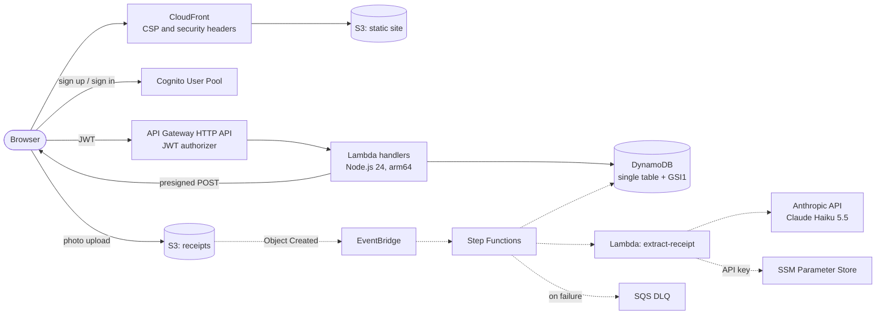

# Receipts App

Serverless expense tracker built from receipt photos: sign up, upload a photo of a receipt, and see your spending by month and category. A portfolio and learning project for the AWS Solutions Architect Associate and Developer Associate certifications, with groundwork for DevOps Pro and GenAI Developer Pro.

The domain is deliberately small. The interesting part is the AWS architecture, kept within the free tier or a few cents a month.

**Live:** https://d320g8bknug8ck.cloudfront.net

## Features

| Feature | Status |
|---|---|
| Sign up, email confirmation (OTP), sign in, password reset | ✅ Done |
| Expenses: list by month, totals by category, create, edit, delete | ✅ Done |
| Upload a receipt photo (presigned POST to S3) | ✅ Backend done, UI pending |
| AI extraction of merchant, total, date and category | 🚧 Extractor done (Claude Haiku 5.5); processing workflow in progress |
| Monthly summary by email | 🔲 Planned |

The UI is bilingual (English by default, Spanish) and follows WCAG 2.2 AA.

## Architecture



Dotted lines are the processing pipeline, which is being built.

### AI extraction

The `extract-receipt` Lambda sends the receipt photo to **Claude Haiku 5.5** through the Anthropic API and gets back JSON that matches the shared Zod contract (`receiptExtractionSchema`), thanks to structured outputs. When the photo is not a readable receipt, the model returns no expense and a reason, instead of guessing, and the receipt is marked `FAILED`.

- **Why not Bedrock:** the original design used Amazon Bedrock. On this new account every Bedrock inference quota is 0, and AWS Support declined to raise them until the account has more usage history (see [Account constraints](#account-constraints)).
- **Swappable provider:** the handler depends on a `ReceiptExtractor` function type, so moving back to Bedrock only needs a new implementation.
- **Secrets:** the API key belongs to a dedicated service account, lives in an SSM `SecureString`, and is read at runtime with Powertools Parameters. It never appears in code, environment variables or CloudFormation.
- **Cost:** about $0.0004 per receipt. The Claude Console organization has a monthly spend limit, so a bug or abuse can't run up the bill.
- **Prompt injection:** text printed on the receipt is treated as data, and the output is validated with Zod like any other external input.

### Request flow

1. The static Next.js export is served from a private S3 bucket through CloudFront with Origin Access Control. A CloudFront Function maps clean URLs (`/sign-in`) to the exported `.html` files, and a response headers policy adds CSP, HSTS and other security headers.
2. The browser talks to Cognito directly (SRP sign-in through Amplify) and keeps short-lived, revocable tokens.
3. Every API route requires the Cognito access token. API Gateway validates the JWT before any Lambda runs, and the user id always comes from the token's `sub`, never from the request.
4. Lambdas validate all input with the shared Zod contracts and read and write a single DynamoDB table. Expenses are listed per month through a GSI with paginated queries.
5. Receipt photos go straight from the browser to S3 with a presigned POST, whose policy (type and size limit) S3 itself enforces.

### Data model (single table)

| Item | PK | SK | GSI1PK | GSI1SK |
|---|---|---|---|---|
| Expense / receipt | `USER#<userId>` | `RECEIPT#<id>` | `USER#<userId>` | `DATE#<yyyy-mm-dd>` |

An expense is a discriminated union on `status`: `PROCESSED` items have merchant, total, currency and category. `PENDING` and `FAILED` items are uploaded receipts that have not been read yet.

## Tech stack

- **Language:** TypeScript (strict) everywhere, TypeScript 7
- **Infrastructure:** AWS CDK v2
- **Frontend:** Next.js 16 static export, React 19, Tailwind CSS v4, Amplify Auth
- **Backend:** AWS Lambda (Node.js 24, arm64) bundled with esbuild, Powertools (Logger, Parameters), AWS SDK v3
- **AI:** Claude Haiku 5.5 through the Anthropic TypeScript SDK, with structured outputs
- **Contracts:** Zod schemas shared by the web, the API and the tests
- **Tests:** Vitest (unit), `aws-cdk-lib/assertions` (infrastructure), an end-to-end smoke test against the deployed API
- **Tooling:** pnpm workspaces, Biome (lint and format), GitHub Actions

## Repository structure

```
receipts-app/
├─ apps/web/            Next.js static site            → apps/web/README.md
├─ services/api/        Lambda handlers                → services/api/README.md
├─ packages/contracts/  Zod schemas and shared types   → packages/contracts/README.md
└─ infra/               CDK app and stacks             → infra/README.md
```

Each package is organized by feature (for example `expenses/`, `receipts/`, `auth/`), with shared code in `shared/`, `lib/` or `components/`.

## Getting started

### Prerequisites

- Node.js 24 and pnpm 12 (`corepack` or the version pinned in `package.json`)
- AWS CLI v2, signed in (`aws login`), default region `us-east-2`
- An AWS account bootstrapped for CDK in `us-east-2`:

```bash
pnpm --filter @receipts-app/infra exec cdk bootstrap aws://<account-id>/us-east-2
```

### Install

```bash
pnpm install
```

### Deploy

From `infra/`:

```bash
pnpm exec cdk deploy AuthStack DataStack ApiStack
```

Copy the stack outputs into `apps/web/.env.local` (see `apps/web/.env.example`), then build the site and deploy it:

```bash
pnpm --filter @receipts-app/web build
```

```bash
pnpm --filter @receipts-app/infra exec cdk deploy WebStack
```

### Run locally

```bash
pnpm --filter @receipts-app/web dev
```

The local site at http://localhost:3000 uses the deployed Cognito pool and API.

## Scripts

Run from the repository root:

| Command | What it does |
|---|---|
| `pnpm check` | Lint and format check (Biome) |
| `pnpm fix` | Apply Biome fixes and formatting |
| `pnpm typecheck` | Type-check contracts, API and infra (the web is type-checked by `next build`) |
| `pnpm test` | Unit and infrastructure tests in every package |
| `pnpm --filter @receipts-app/api smoke` | End-to-end test against the deployed API (asks for an access token) |

## Quality and CI

- **Unit tests** cover the pure logic: DynamoDB key mapping and update expressions, money formatting, month logic and the client cache, form schemas.
- **Infrastructure tests** turn the project rules into checks:
  - every API route requires the JWT authorizer
  - no IAM statement in the API grants `*`
  - buckets are private
  - the table is on-demand
  - Lambdas run on Node.js 24 and arm64
  - log groups keep one week of logs
  - CloudFront sends the security headers
- **Smoke test:** exercises the deployed API end to end, including a real presigned upload to S3 and checks that S3 rejects a mismatched file type.
- **GitHub Actions** (`.github/workflows/ci.yml`) runs lint, type-check, the web build and all tests on every push and pull request, on Linux.

### Continuous deployment

Every push to `main` that passes the checks is deployed by the `deploy` job of the same workflow:

1. It runs only after `verify` succeeds, only for pushes to `main` (never for pull requests), and one at a time (`concurrency`).
2. It uses the GitHub environment `production`, which only `main` can deploy to. The environment holds the AWS credentials as secrets and the public `NEXT_PUBLIC_*` values as variables.
3. It builds the site with the real values and runs `cdk deploy --all`.

AWS access goes through the `github-deployer` IAM user (`CiStack`). Its only permission is `sts:AssumeRole` on the CDK bootstrap roles, so the key alone can't read or change anything: every change goes through CloudFormation. An access key is used instead of OIDC because of the account's SCP (see [Account constraints](#account-constraints)).

## Security

- Least-privilege IAM through CDK `grant*` methods: for example, the list Lambda can only read, and the upload Lambda can only write under `receipts/*`.
- Cognito:
  - access token of 1 hour, refresh token of 7 days, token revocation on sign-out
  - `preventUserExistenceErrors` enabled
  - unconfirmed accounts can only be resumed from sign-in, after the password is proven, to prevent pre-account takeover
- CloudFront:
  - Origin Access Control; both buckets block all public access and require TLS
  - CSP whose `connect-src` only allows the API and Cognito, plus HSTS, `nosniff`, frame and referrer policies
- All external input (API bodies, query strings, environment variables, items read from DynamoDB) is validated with Zod.

## Costs

Everything runs on serverless, pay-per-use services: CloudFront, S3, Lambda, API Gateway HTTP API, DynamoDB on-demand and Cognito Lite. At personal-use volumes the project stays within the free tier, or a few cents a month. There are no NAT gateways, EC2 instances or databases with hourly cost. Every stack can be removed with `cdk destroy`.

## Account constraints

The project runs on an AWS Free plan account, whose organization service control policies (SCPs) shape some decisions:

| Constraint | Effect on the project |
|---|---|
| Only `us-east-2` is allowed | Everything is deployed there. No custom domain, because the ACM certificate for CloudFront must live in `us-east-1`. |
| Bedrock inference quotas are 0 | AWS Support declined the increase until the account has more usage. AI extraction uses the Anthropic API instead (see [AI extraction](#ai-extraction)). |
| Textract is denied by an SCP | It can't be used as an alternative extractor. |
| IAM OIDC providers are denied | GitHub Actions can't use OIDC. It deploys with the access key of an IAM user that can only assume the CDK bootstrap roles, kept in a protected environment. This is a temporary exception: once the account allows OIDC, the key will be replaced by an OIDC role and deleted. |

## Roadmap

1. ✅ **Base:** monorepo, CDK bootstrap, Cognito, site on CloudFront
2. ✅ **API:** expenses CRUD with API Gateway, Lambda and DynamoDB
3. 🚧 **Processing:** presigned uploads ✅, AI extraction with Claude ✅; EventBridge and Step Functions workflow in progress
4. 🔲 **Resilience and notifications:** DLQ, retries, idempotency, cleanup jobs (TTL for abandoned uploads, unconfirmed users), monthly email summary with SES
5. 🚧 **Operations:** tests, CI and continuous deployment ✅; observability and alarms pending
